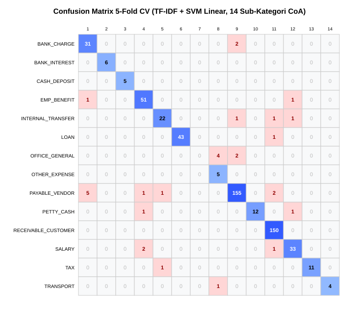
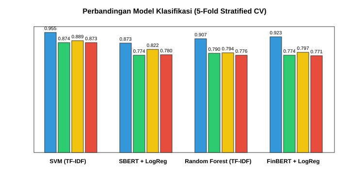
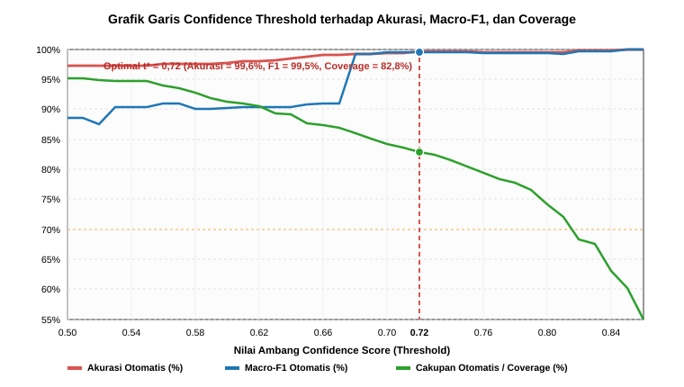

# BAB 4 HASIL DAN PEMBAHASAN (DRAFT UNTUK BIMBINGAN)

> **Status draf:** angka diambil dari hasil eksekusi program pada repositori. Bagian bertanda **[TODO]** menunggu data/validasi (kappa, Pool 3). Seluruh akurasi di bawah dihitung terhadap *label perak* (aturan otomatis) yang **belum divalidasi** staf keuangan; lihat 4.8.

## 4.1 Gambaran Implementasi
Modul NLP (Pool 2) diimplementasikan dengan Python (scikit-learn, sentence-transformers, transformers). Alur: data mutasi (kolom tanggal, keterangan, debit, kredit, saldo) → penentuan arah (CR bila kredit > 0, selain itu DB) → preprocessing → TF-IDF → SVM → confidence score → routing. Keluaran berupa JSON berisi label, nama akun, confidence, dan status `OTOMATIS` atau `PERLU_REVIEW_MANUAL`. Transaksi berstatus review diperiksa manual di Pool 3, setelah itu dihasilkan JSON bersih untuk pencocokan ke ERP.

| Berkas | Fungsi |
|---|---|
| `siapkan_data_coa.py` | parsing data BCA & Mandiri, pelabelan awal berbasis aturan, bahan validasi 20% |
| `kamus_istilah.py` | normalisasi, kamus singkatan, stopword |
| `latih_model_coa.py` | 5-fold CV, uji lintas-bank, model final |
| `bandingkan_model_coa.py` | perbandingan SVM, RF, SBERT, FinBERT + paired t-test |
| `eksperimen_perbaikan.py` | perbandingan kernel RBF vs Linear, uji masking nama pihak & GroupKFold |
| `threshold_coa.py` | penentuan confidence threshold (StratifiedKFold & GroupKFold) |
| `routing.py`, `proses_json.py` | inferensi, routing, kontrak JSON ke Pool 3 |

## 4.2 Dataset dan Pelabelan
Data riil terdiri atas **606 transaksi** (BCA 337 dari rekening koran 2023; Mandiri 269 dari data dummy 2025) yang diberi label sub-kategori berdasarkan Chart of Accounts (CoA) perusahaan mitra. Sebanyak 40 transaksi berlabel `PERLU_REVIEW` (belum dapat ditentukan dari teks) dikeluarkan dari pemodelan. Distribusi label sangat tidak seimbang:

| Label | Jumlah | Label | Jumlah |
|---|---|---|---|
| PAYABLE_VENDOR | 164 | OFFICE_GENERAL | 6 |
| RECEIVABLE_CUSTOMER | 150 | BANK_INTEREST | 6 |
| EMP_BENEFIT | 53 | OTHER_EXPENSE | 5 |
| LOAN | 44 | CASH_DEPOSIT | 5 |
| SALARY | 36 | TRANSPORT | 5 |
| BANK_CHARGE | 33 | UTILITIES, REVENUE_OTHER, REPAIR_MAINT | 2 |
| INTERNAL_TRANSFER | 25 | COMMUNICATION, TRAVEL | 1 |
| PETTY_CASH | 14 | TAX | 12 |

Label dengan kurang dari 5 contoh tidak dievaluasi; `COMMUNICATION`, `REVENUE_OTHER`, `UTILITIES` ditambah data sintesis pada model final, sedangkan `REPAIR_MAINT` dan `TRAVEL` (< 3 contoh) belum dapat dilatih. **[TODO]** Validasi 20% oleh staf keuangan dan Cohen's Kappa (target ≥ 0,61): bahan sudah tersedia (`sampel_validasi_20persen.xlsx`), menunggu pengisian validator.

## 4.3 Hasil Preprocessing dan Ekstraksi Fitur
Pada 566 transaksi berlabel:

| Metrik | Nilai |
|---|---|
| Token sebelum → sesudah | 2.761 → 1.821 |
| Token Reduction Rate | 34,05% |
| Vocabulary Size | 326 |
| Average Token Length | 3,22 token/transaksi |
| Token singkatan terpetakan kamus | 122 |
| Jumlah fitur TF-IDF (unigram+bigram) | 754 |
| Sparsity | 99,28% |

Sparsity yang jauh di atas 95% mengonfirmasi bahwa representasi TF-IDF bersifat sparse sehingga sesuai dengan SVM (Bab 3.2.5). Sebanyak 9 transaksi menjadi kosong setelah preprocessing, sehingga perlu dialihkan langsung ke review manual. Token berbobot tertinggi per label umumnya relevan (`gaji`, `thr` untuk SALARY; `bpjs`, `kesehatan` untuk EMP_BENEFIT; `loan`, `return` untuk LOAN; `administrasi`, `biaya` untuk BANK_CHARGE), tetapi pada beberapa label didominasi **nama pihak** (mis. "santosa makmur jaya", "bareka lintas indo"), yang menunjukkan model sebagian mengenali pihak transaksi, bukan hanya jenis transaksinya.

## 4.4 Hasil Klasifikasi (5-fold Cross-Validation)
| Metode | Akurasi | Macro-F1 |
|---|---|---|
| Baseline (hanya arah CR/DB) | 0,563 | 0,106 |
| TF-IDF kata + SVM | 0,952 | 0,893 |
| TF-IDF kata+karakter n-gram + SVM | 0,955 | 0,895 |

NLP menaikkan Macro-F1 dari 0,106 (baseline) ke 0,895, sehingga kontribusi analisis teks nyata. Per bank: BCA F1 0,967 dan Mandiri 0,805; Mandiri lebih rendah karena variasi keterangan lebih besar dan jumlah per label kecil. F1 per label:

| Label | P | R | F1 | n |
|---|---|---|---|---|
| RECEIVABLE_CUSTOMER | 0,97 | 1,00 | 0,99 | 150 |
| LOAN | 1,00 | 0,98 | 0,99 | 44 |
| PAYABLE_VENDOR | 0,99 | 0,94 | 0,96 | 164 |
| INTERNAL_TRANSFER | 0,93 | 1,00 | 0,96 | 25 |
| TAX | 1,00 | 0,92 | 0,96 | 12 |
| EMP_BENEFIT | 0,93 | 0,98 | 0,95 | 53 |
| SALARY | 0,97 | 0,92 | 0,94 | 36 |
| PETTY_CASH | 1,00 | 0,86 | 0,92 | 14 |
| BANK_CHARGE | 0,82 | 0,97 | 0,89 | 33 |
| TRANSPORT | 0,80 | 0,80 | 0,80 | 5 |
| OTHER_EXPENSE | 0,75 | 0,60 | 0,67 | 5 |
| OFFICE_GENERAL | 0,50 | 0,50 | 0,50 | 6 |
| BANK_INTEREST, CASH_DEPOSIT | 1,00 | 1,00 | 1,00 | 6; 5 |

Label minoritas dan bersifat "lain-lain" (`OFFICE_GENERAL`, `OTHER_EXPENSE`) paling lemah dan cenderung tertelan ke `PAYABLE_VENDOR`. Hal ini selaras dengan alasan pemakaian macro-average (Persamaan 3.3). Matriks konfusi (*confusion matrix*) lengkap berukuran 14×14 untuk seluruh sub-kategori disimpan pada `data/confusion_matrix_coa.csv` dan divisualisasikan pada **Gambar 4.1** (`docs/gambar_4_1_confusion_matrix.png`).

## 4.5 Perbandingan dengan Random Forest, SBERT, dan FinBERT
| Model | Accuracy | Precision (macro) | Recall (macro) | F1 macro (mean ± std) |
|---|---|---|---|---|
| **SVM (TF-IDF)** | **0,955** | **0,874** | **0,889** | **0,873 ± 0,068** |
| SBERT + LogReg | 0,873 | 0,774 | 0,822 | 0,780 ± 0,051 |
| Random Forest (TF-IDF) | 0,907 | 0,790 | 0,794 | 0,776 ± 0,037 |
| FinBERT + LogReg | 0,923 | 0,774 | 0,797 | 0,771 ± 0,021 |

Paired t-test pada F1 per fold (α = 0,05): SVM vs FinBERT t = 3,951, **p = 0,017 (signifikan)**; SVM vs Random Forest p = 0,078 dan SVM vs SBERT p = 0,135 (**tidak signifikan**); pasangan lainnya tidak signifikan (p > 0,75). Perbandingan visual keempat model disajikan pada **Gambar 4.3** (`docs/gambar_4_3_perbandingan_model.png`). **Pembahasan:** SVM unggul secara nilai pada semua metrik, tetapi dengan lima fold dan data kecil keunggulan atas RF dan SBERT belum terbukti signifikan; yang dapat dinyatakan adalah SVM setidaknya setara dan lebih ringan secara komputasi (tanpa GPU, tanpa unduh model), serta signifikan lebih baik dari FinBERT. FinBERT yang dilatih pada bahasa Inggris keuangan kurang cocok untuk teks mutasi berbahasa Indonesia dengan singkatan tidak baku. Catatan: SBERT dan FinBERT digunakan sebagai ekstraktor embedding dengan Logistic Regression di atasnya (bukan fine-tuning penuh seperti rancangan awal di Bab 3.2.6), sehingga perbedaan ini perlu disebut sebagai keterbatasan.

### 4.5.1 Justifikasi Kernel (RBF vs Linear) dan Uji Ketahanan terhadap Duplikasi serta Nama Pihak
Proposal menetapkan kernel RBF. Untuk menjustifikasi pilihan implementasi, RBF (C = 1, gamma = scale) dibandingkan dengan SVM linear pada fitur yang sama (`eksperimen_perbaikan.py`). Selain itu, dilakukan dua uji ketahanan: (a) *masking* token nama pihak (112 token), dan (b) **GroupKFold**, yaitu semua baris dengan teks identik ditempatkan pada fold yang sama sehingga model diuji pada teks yang belum pernah dilihat. Uji (b) diperlukan karena dari 558 baris hanya terdapat **244 teks unik (56% duplikat)**, sehingga CV biasa dapat menggelembungkan angka.

| Fitur | Validasi | Kernel | Akurasi | Macro-F1 |
|---|---|---|---|---|
| Dengan nama pihak | StratifiedKFold | **Linear** | **0,955** | **0,873** |
| Dengan nama pihak | StratifiedKFold | RBF | 0,919 | 0,782 |
| Dengan nama pihak | GroupKFold (teks baru) | **Linear** | **0,843** | **0,737** |
| Dengan nama pihak | GroupKFold (teks baru) | RBF | 0,748 | 0,586 |
| Tanpa nama pihak | StratifiedKFold | Linear | 0,891 | 0,805 |
| Tanpa nama pihak | StratifiedKFold | RBF | 0,866 | 0,722 |
| Tanpa nama pihak | GroupKFold (teks baru) | Linear | 0,808 | 0,684 |
| Tanpa nama pihak | GroupKFold (teks baru) | RBF | 0,682 | 0,521 |

**Pembahasan.** (1) Kernel linear lebih unggul daripada RBF pada seluruh skenario (selisih Macro-F1 0,09–0,15). Hal ini sejalan dengan teori bahwa data teks TF-IDF berdimensi tinggi dan sparse umumnya sudah terpisah secara linear, sedangkan RBF cenderung overfit pada data kecil. Deviasi dari proposal (RBF → linear) dengan demikian memiliki dasar empiris. (2) Ketika diuji pada teks yang belum pernah dilihat, Macro-F1 turun dari 0,873 ke **0,737**; angka inilah estimasi yang lebih jujur untuk transaksi baru. (3) Menghapus nama pihak menurunkan kinerja (0,873 → 0,805), sehingga nama pihak berfungsi sebagai sinyal yang sah (pelanggan/vendor langganan dipetakan ke akun tertentu seperti pada praktik staf keuangan), bukan sekadar bias; namun sinyal ini tidak berlaku untuk pihak baru, yang menjelaskan mengapa transaksi dengan pihak baru perlu dirujuk ke Pool 3 melalui confidence threshold. Catatan: nilai F1 pada subbab ini dirata-rata per fold (0,873) sedangkan subbab 4.4 dihitung dari seluruh prediksi gabungan (0,895); keduanya konsisten dan perlu disebutkan metodenya.

## 4.6 Confidence Threshold dan Routing
Confidence adalah probabilitas SVM terkalibrasi, dihitung *out-of-fold* (tanpa kebocoran data). Hasil grid 0,50–0,99:

| Threshold | Auto-classification rate | KB referral rate | Akurasi (auto) | F1 macro (auto) | Salah yang lolos | Salah yang dialihkan |
|---|---|---|---|---|---|---|
| 0,50 | 95,2% | 4,8% | 0,972 | 0,886 | 15 | 15 |
| 0,60 | 91,2% | 8,8% | 0,976 | 0,901 | 12 | 18 |
| 0,70 | 84,2% | 15,8% | 0,994 | 0,994 | 3 | 27 |
| **0,72 (optimal)** | **82,8%** | **17,2%** | **0,996** | **0,995** | **2** | **28** |
| 0,80 | 74,2% | 25,8% | 0,995 | 0,993 | 2 | 28 |
| 0,90 | 5,0% | 95,0% | 1,000 | 1,000 | 0 | 30 |

Threshold optimal **0,72** (F1 tertinggi dengan syarat auto-rate ≥ 70%). Pada titik ini 82,8% transaksi diproses otomatis dengan akurasi 99,6%, dan **28 dari 30 kesalahan model berhasil dialihkan** ke pemeriksaan manual. Threshold di atas 0,80 tidak praktis karena hampir semua transaksi dialihkan. Contoh nyata: "BIAYA ADM" → `BANK_CHARGE` (0,87, otomatis) sedangkan "pulsa kantor jan" → `PAYABLE_VENDOR` (0,45, dialihkan ke review manual), yang memang tepat karena kata "pulsa" belum dikenal model.

Sebagai analisis sensitivitas terhadap transaksi yang benar-benar baru (*StratifiedGroupKFold*, di mana teks identik tidak boleh terpecah antar fold), pada $\tau = 0,72$ tingkat otomatisasi menjadi 60,0% dengan akurasi 94,0% dan Macro-F1 0,773 (69 dari 89 kesalahan berhasil dialihkan ke Pool 3); jika syarat auto-rate ≥ 70% dipaksakan pada skema ini, threshold turun ke $\tau^* = 0,58$ (auto-rate 80,5%, akurasi 91,3%, Macro-F1 0,755, 50 dari 89 kesalahan dialihkan). Sistem tetap menggunakan **$\tau^* = 0,72$** sebagai konfigurasi utama karena lebih konservatif (meminimalkan kesalahan yang lolos otomatis pada transaksi baru maupun berulang). Kurva *trade-off* antara nilai *threshold*, Macro-F1, dan *Auto-Classification Rate* ditunjukkan pada **Gambar 4.2** (`docs/gambar_4_2_kurva_threshold.png`).

Selanjutnya, dilakukan evaluasi metrik *Confidence Routing* dan integrasi *Knowledge Base* (Pool 3) sesuai tabel metrik pada Bab 3.2.7 (`evaluasi_routing_kb.py`). Terhadap 96 transaksi yang memiliki *confidence* < 0,72, dilakukan simulasi aturan *forward-chaining* berbasis referensi entitas ERP, pencocokan nominal mutasi/invoice historis, dan kamus operasional:

| Metrik | Jumlah Transaksi | Nilai (%) |
|---|---|---|
| **Auto-Classification Rate** (diproses otomatis di Pool 2) | 462 / 558 | **82,80%** |
| **KB Referral Rate** (dirujuk ke Pool 3 karena confidence < 0,72) | 96 / 558 | **17,20%** |
| **KB Resolution Rate** (berhasil diselesaikan aturan Pool 3) | 66 / 96 | **68,75%** |
| **Overall System Coverage** (total tertangani Pool 2 + Pool 3) | 528 / 558 | **94,62%** |
| Sisa Review Manual Staf Keuangan | 30 / 558 | 5,38% |
| Akurasi Klasifikasi Otomatis Pool 2 | 462 baris | 99,57% |
| Akurasi Sistem Hibrida (Pool 2 + Pool 3) | 528 baris | 98,11% |

Dari 96 transaksi yang dirujuk ke Pool 3, sebanyak 66 transaksi (68,75%) berhasil diselesaikan melalui pencocokan referensi entitas ERP (25 transaksi), pencocokan nominal invoice/mutasi (20 transaksi), dan aturan kamus operasional (11 transaksi), sehingga *Overall System Coverage* mencapai **94,62%** dengan akurasi gabungan **98,11%**. Hanya **5,38% (30 transaksi)** yang benar-benar memerlukan konfirmasi manual staf keuangan pada antarmuka Pool 3, sebelum menghasilkan JSON bersih (`proses_json.py`) untuk pencocokan akhir ke ERP.

## 4.7 Uji Lintas-Bank (Generalisasi)
| Latih → Uji | Sintesis | Akurasi | Macro-F1 | Baseline arah (F1) |
|---|---|---|---|---|
| BCA → Mandiri | tanpa | 0,569 | 0,370 | 0,152 |
| BCA → Mandiri | dengan | 0,540 | 0,412 | 0,103 |
| Mandiri → BCA | tanpa | 0,470 | 0,364 | 0,007 |
| Mandiri → BCA | dengan | 0,442 | 0,318 | 0,166 |

Model yang dilatih pada satu bank turun tajam saat diuji di bank lain (F1 ≈ 0,32–0,41), walau tetap di atas baseline. Penyebabnya: kosakata dan format keterangan berbeda antar bank, serta ketergantungan pada nama pihak. Data sintesis tidak memberi perbaikan konsisten. **Implikasi:** model harus dilatih dengan data gabungan semua bank, dan data tambahan dari mitra (Avolut) menjadi kunci.

## 4.8 Keterbatasan dan Ancaman Validitas
1. **Label belum divalidasi.** Label berasal dari aturan kata kunci; baris dengan aturan eksplisit mencapai F1 0,968 karena model dan aturan sama-sama membaca teks yang sama (risiko sirkularitas). Angka sebenarnya baru diketahui setelah validasi staf keuangan (kappa).
2. **Data kecil dan tidak seimbang;** beberapa label < 5 contoh. Mandiri adalah data dummy.
3. **Duplikasi dan ketergantungan pada nama pihak.** 56% baris merupakan teks duplikat; pada teks yang belum pernah dilihat Macro-F1 turun menjadi 0,737 (4.5.1), dan analisis sensitivitas threshold dengan GroupKFold sudah disajikan pada subbab 4.6. Generalisasi lintas-bank juga lemah (4.7).
4. **Bank BNI, BRI, dan BSI** pada batasan masalah belum terwakili dalam data.
5. **Deviasi dari rancangan proposal:** SVM linear (bukan RBF; sudah dijustifikasi secara empiris pada 4.5.1) dan fitur kata + karakter n-gram; SBERT/FinBERT sebagai embedding + LogReg (bukan fine-tuning penuh).

## 4.9 Rencana Penyelesaian
1. Validasi 20% sampel oleh staf keuangan, hitung Cohen's Kappa, revisi aturan bila < 0,61, latih ulang.
2. Tambah data dari Avolut (bank lain, label minoritas, lebih banyak pihak berbeda).
3. Integrasi dengan Pool 3 (Mario) untuk metrik KB Resolution Rate dan Overall Coverage.
4. Tulis Bab 5 (kesimpulan dan saran).

